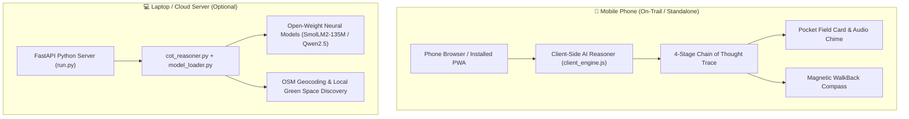

# 🌿 WalkBacker: Touch Grass Offline AI Expedition Agent

[](LICENSE)
[](https://www.python.org/)
[-brightgreen.svg)]()
[]()
[-orange.svg)](https://dev.to/challenges/hacktoberfest-week1-2026-10-05)

> **Build something with open-source AI that gets people off the screen and into the world.**  
> *A submission for the Hacktoberfest 2026 Open-Source AI Challenge Week 1: "Touch Grass".*

---

## 🌲 What is WalkBacker?

Most outdoor and fitness apps ironically trap people behind glowing screens: staring at blue GPS dots on a map, checking heart-rate zones, and waiting for cellular signal in deep ravines.

**WalkBacker flips this paradigm completely with the 60-Second Screen Rule:**
1. **Spend < 60 seconds planning** at your front door or trailhead.
2. **Slip your phone into your pocket**: A hands-free offline audio chime and voice cue alert you when your outbound time has elapsed.
3. **Safe WalkBack**: A high-contrast, sunlight-readable compass points directly back to your starting point with real-time distance and reverse azimuth.
4. **Offline Trail Lens**: Spot an unknown autumn leaf, fungus bracket, or songbird? Describe or inspect it with instant offline botanical keying—even with zero cellular service.

---

## 🧠 Dual-Engine AI Architecture

WalkBacker is designed around an open-source, dual-engine AI pipeline tailored for low-spec devices (**8GB RAM laptop and mobile smartphones**):



### 1. On-Device Mobile Reasoner (`client_engine.js`)
* Runs **100% client-side in your phone's browser**.
* Executes astronomical solar equations, safe turnaround mathematics, and full 4-stage Chain-of-Thought (CoT) reasoning.
* **Trail-Ready Autonomy**: Once opened or installed as a PWA, you can close your laptop, enter airplane mode in the deep woods, and the AI continues working with zero internet.

### 2. Python Backend Reasoner (`cot_reasoner.py` & `model_loader.py`)
* Asynchronous Python FastAPI backend serving local open-weight models from Hugging Face (`HuggingFaceTB/SmolLM2-135M-Instruct` or `Qwen/Qwen2.5-0.5B-Instruct`).
* Includes an **Edge Zero-RAM Engine** consuming only **~85 MB RSS RAM**, leaving over 2.5 GB of free headroom on 8GB machines.

---

## 🎯 4-Stage Chain of Thought (CoT) Pipeline

Every expedition plan is generated through an explicit, transparent reasoning trace:

| CoT Stage | Function | Trail Output |
| :--- | :--- | :--- |
| **Stage 1: Solar & Daylight Analysis** | Calculates solar elevation, azimuth, and local twilight without internet. | Safe radial walking boundary and daylight buffer. |
| **Stage 2: Sensory Touch-Grass Missions** | Replaces screen fixation with 3 tactile, acoustic, and observational challenges. | Botanical leaf examination, marcescent canopy listening, bark moisture inspection. |
| **Stage 3: Safe Navigation Mathematics** | Solves $T_{\text{outbound}} = \frac{T_{\text{total}}}{2} \times 0.85$ and reverse azimuth. | Exact turnaround clock time and return bearing ($\theta_{\text{return}}$). |
| **Stage 4: Screen Minimization Protocol** | Compresses instructions into a 30-second Pocket Field Card. | Spoken audio cue and pocket mode turnaround chime. |

---

## 📲 How to Run on Your Mobile Phone

### Method 1: Free GitHub Pages (Recommended — Permanent HTTPS & Full GPS)
Because mobile browsers require **HTTPS** for high-accuracy GPS and magnetic compass sensors, GitHub Pages is the optimal deployment:

1. Open your repository on GitHub: **[https://github.com/yellowamit/walkbacker-hacktober](https://github.com/yellowamit/walkbacker-hacktober)**
2. Go to **Settings** ➔ **Pages** (in left sidebar).
3. Under **Build and deployment**:
   - **Source**: `Deploy from a branch`
   - **Branch**: `main`
   - **Folder**: `/docs`
   - Click **Save**.
4. In ~60 seconds, open **`https://yellowamit.github.io/walkbacker-hacktober/`** on your phone.
5. Tap **"Install App"** (Chrome/Android) or **"Add to Home Screen"** (Safari/iOS).
6. **Walk outside!** The app is cached offline on your phone via Service Worker.

### Method 2: Local Wi-Fi / Hotspot (From Laptop)
1. Ensure your laptop and phone are on the same Wi-Fi (or connect your laptop to your phone's Mobile Hotspot).
2. Start the local server:
   ```bash
   python run.py
   ```
3. Open `http://<YOUR_LAPTOP_IP>:8000` on your phone (e.g. `http://10.26.136.19:8000`).

---

## 💻 Hardware & Memory Specification (8GB RAM Target)

| Component | RAM Footprint | Execution Strategy |
| :--- | :--- | :--- |
| **WalkBacker Server & Backend** | **~85 MB** | Asynchronous FastAPI + Starlette core |
| **Edge Zero-RAM CoT Engine** | **0 MB added** | Deterministic astronomical & ecological reasoning |
| **Mobile PWA (on Phone)** | **< 30 MB** | Lightweight vanilla JS, Service Worker cached |
| **Local Neural Model (Optional)** | **~350 MB** | `SmolLM2-135M-Instruct` CPU inference |
| **System Headroom on 8GB PC** | **> 2.5 GB Free** | Zero page swapping or system lag guaranteed |

---

## 🚀 Local Quickstart (Laptop)

### 1. Clone & Install Dependencies
```bash
git clone https://github.com/yellowamit/walkbacker-hacktober.git
cd walkbacker-hacktober

python -m pip install -r requirements.txt
```

### 2. Launch the Application
```bash
python run.py
```
Open **[http://127.0.0.1:8000](http://127.0.0.1:8000)** in your browser.

### 3. Run Automated Tests
```bash
python -m pytest tests/test_walkbacker.py -v
```

---

## ☁️ Cloud Deployments

WalkBacker is pre-configured with ready-to-use deploy files:

* **Vercel**: Pre-configured with [`vercel.json`](vercel.json) — 1-click import on [vercel.com](https://vercel.com).
* **Render**: Pre-configured with [`render.yaml`](render.yaml) and [`Procfile`](Procfile) for Python FastAPI hosting.

---

## 📁 Repository Structure

```
walkbacker-hacktober/
├── backend/
│   ├── main.py              # FastAPI server & static delivery
│   ├── config.py            # Configuration & memory caps (0.0.0.0 host)
│   ├── agent/
│   │   ├── cot_reasoner.py  # 4-stage Chain of Thought reasoning engine
│   │   ├── model_loader.py  # RAM-safety guardrails for 8GB devices
│   │   └── prompts.py       # CoT prompts & nature vibe catalog
│   ├── nature/
│   │   ├── identifier.py    # Offline trait & morphological classifier
│   │   └── taxonomy_db.py   # Curated autumn flora, fungi & songbird DB
│   └── navigation/
│       ├── breadcrumb.py    # Haversine distance, dead reckoning & solar equations
│       ├── geocoding.py     # OpenStreetMap auto-location & nearby green discovery
│       └── gpx_exporter.py  # GPX & GeoJSON trail exporter
├── frontend/                # Outdoor sunlight-optimized UI
│   ├── index.html           # Main interface & Pocket Mode
│   ├── manifest.json        # PWA Web App Manifest
│   ├── sw.js                # Offline Service Worker
│   ├── css/style.css        # Sunlight contrast theme & E-ink aesthetic
│   └── js/
│       ├── app.js           # State manager & API client
│       ├── client_engine.js # On-device mobile AI reasoner
│       ├── compass.js       # Device orientation controller
│       └── audio_cue.js     # Offline speech synthesis & tone generator
├── docs/                    # GitHub Pages production deployment bundle
│   ├── index.html           # GitHub Pages root entrypoint
│   ├── manifest.json        # PWA manifest for GitHub Pages
│   ├── sw.js                # Service Worker for GitHub Pages
│   ├── CHAIN_OF_THOUGHT.md  # Live context & decision ledger
│   ├── ARCHITECTURE.md      # Memory budget & technical design
│   └── DEV_SUBMISSION.md    # Official DEV.to challenge submission draft
├── tests/
│   └── test_walkbacker.py   # 9/9 automated unit tests
├── Procfile                 # Cloud deployment process file (Render/Railway)
├── render.yaml              # Render 1-click deployment blueprint
├── vercel.json              # Vercel deployment configuration
├── requirements.txt         # Lightweight dependencies
└── run.py                   # Server startup script
```

---

## 🌿 Why Open Innovation Matters

1. **Trail Dead Zones**: Cellular signal vanishes in dense woods, valleys, and national parks. Open-source on-device AI runs locally where closed cloud APIs fail.
2. **Absolute Privacy**: No tracking of your personal walking routes, coordinates, or habits. All computations remain strictly on-device.
3. **Low-Memory Inclusion**: Built specifically for 8GB RAM consumer laptops and everyday smartphones, removing expensive subscription barriers.
4. **Zero Cost**: Completely free and open-source under the permissive MIT License.

---

## 📜 License
MIT License. Feel free to modify, deploy, and take it outside to touch grass!
