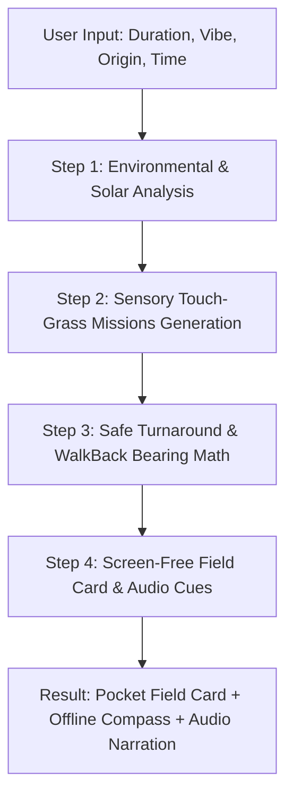

# WalkBacker Architecture & Memory Budget Specification

## Overview
**WalkBacker** is an open-source, offline-first outdoor exploration engine designed specifically for low-memory personal hardware (8 GB total RAM). It is built to satisfy the **"Touch Grass"** Hacktoberfest 2026 challenge by making screen interaction minimal (< 60 seconds), keeping all location and biometric data strictly private on-device, and functioning completely off-grid without internet connectivity.

---

## 1. Hardware & Memory Footprint Budget (8 GB System)

| Component | Target Memory Allocation | Implementation Strategy |
| :--- | :--- | :--- |
| **Operating System & Browser** | ~4.5 GB | Uncontrolled baseline (Windows + Chrome/Edge) |
| **WalkBacker Backend (FastAPI)** | ~60 MB | Asynchronous Python 3.14 server with Starlette core |
| **Local Open-Weight AI Reasoner** | ~250 MB – 550 MB | SmolLM2-135M / Qwen2.5-0.5B loaded with float16/int8 or CPU quantized weights. Also includes an instant-response deterministic CoT fall-back engine. |
| **Offline Nature Identifier** | ~80 MB | Lightweight embedded taxonomy & feature extractor (no multi-gigabyte vision models). |
| **Frontend Assets & In-Memory Breadcrumbs** | ~30 MB | Vanilla JavaScript & CSS; no bloated Electron wrappers or heavy JS frameworks. |
| **Safety Headroom** | **> 2.5 GB Free** | System guarantees zero paging/swapping on 8GB machines. |

---

## 2. Multi-Stage Chain of Thought (CoT) Engine

The heart of WalkBacker is the **Chain-of-Thought Expedition Reasoner (`cot_reasoner.py`)**. Rather than generating a generic conversational response, the agent decomposes outdoor walk planning into a rigorous 4-step CoT sequence:

### Stage 1: Environmental & Solar Analysis (`<thought_environment>`)
- Computes local solar position, twilight horizon, and daylight window remaining.
- Determines safe outbound walking radius:
  $$\text{Max Outbound Distance} = \text{Walking Speed (4.5 km/h)} \times \left( \frac{\text{Duration}}{2} \right) \times \text{Safety Factor (0.85)}$$
- Analyzes thermal, wind, and autumn foliage conditions based on seasonal date.

### Stage 2: Sensory Touch-Grass Missions (`<thought_sensory>`)
- Replaces screen-based gamification (checking steps or badges) with mindful, sensory connection to the natural world.
- Generates 3 tactile and acoustic micro-missions:
  - *Auditory*: "Close eyes for 60 seconds at midway point; listen for birdsong or water movement."
  - *Botanical*: "Locate two contrasting leaf morphologies (e.g. lobed oak vs serrated beech)."
  - *Textural*: "Observe bark furrows or moss growth direction (north vs south facing)."

### Stage 3: Safe Turnaround & WalkBack Mathematics (`<thought_navigation>`)
- Calculates exact **Turnaround Timestamp**.
- Generates outward heading recommendations and computes reverse compass vector for the walk back.
- Estimates elevation and terrain buffer.

### Stage 4: Screen-Free Delivery Artifacts (`<field_card>`)
- Compact pocket card designed to be read in under 30 seconds before putting phone away.
- Synthesized speech cues for audio earphones (Web Speech API).
- Dynamic minimal compass interface displaying only:
  - Target bearing home.
  - Minutes until mandatory turnaround.
  - Return distance.

---

## 3. Privacy & Offline Autonomy
- **Zero Cloud Leakage**: No telemetry, no GPS coordinates transmitted across the web.
- **Off-Grid Trail Capability**: Functions completely in airplane mode or in remote wilderness areas with zero cellular reception.
- **Open-Source Reproducibility**: Uses open-weight models from Hugging Face and open standards (GPX, GeoJSON).
